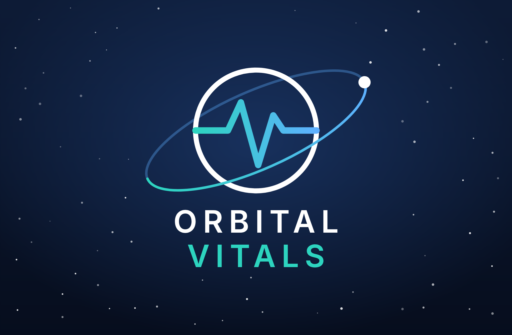

# HALO · Health Autonomy Loop for Orbit

<p align="center"></p>

**Team:** Orbital Vitals · NASA Space Apps Challenge 2026, Sydney · Challenge: *Create Health Monitoring Software for Astronauts on Space Missions*


**NASA Space Apps Challenge 2026 · Challenge: Create Health Monitoring Software for Astronauts on Space Missions · Sydney Local Event**

> When the flight surgeon is up to 20 minutes away, HALO is the astronaut's health copilot. It learns each astronaut's own baseline, spots drift before it becomes an emergency, ties every change to NASA's five spaceflight hazards (RIDGE), and says exactly what to do next.

**Core insight:** spaceflight shifts everyone's physiology, so population averages mislead. HALO judges each astronaut against their *own* baseline, explains every flag, and acts on its own when Earth can't respond in time.

> ⚠️ Simulated crew data · fictional crew · **not a medical device**. Absolute thresholds come from **published clinical guidelines** (AHA, NHLBI, CDC, ADA, AASM); drift parameters and triage steps are illustrative, not medical advice. Space-weather events are **real NASA CCMC DONKI records**.

**Live demo:** https://reihooneh.github.io/halo-nasa-space-apps-2026/ (installable, works offline after the first visit)

**7-slide pitch deck:** [docs/HALO-Orbital-Vitals-pitch-deck.pdf](docs/HALO-Orbital-Vitals-pitch-deck.pdf)

---

## Run it

```bash
npm install
npm run dev          # http://localhost:5173
npm test             # 73 unit tests (drift engine, guideline triage, clinical categories, hash chain, scenario, sensors, Bland–Altman, voice grammar)
npm run build        # static site in dist/ (deploy to Netlify, Vercel or GitHub Pages)
npm run build:single # one self-contained offline file: dist-single/index.html
npm run e2e          # every-button end-to-end test, 128 checks (needs Chrome; CHROME=/path/to/chrome)
npm run a11y         # axe-core WCAG 2.1 A/AA audit of every view and mode
```

`dist-single/index.html` (shipped as `halo.html`) runs by double-click, fully offline, with fonts bundled.

**Deploy:** every push to `main` builds and publishes to GitHub Pages to the `gh-pages` branch via `.github/workflows/pages.yml` (Settings → Pages → Branch: `gh-pages`). `vite.config.ts` uses `base: './'`, so any sub-path works. The production build is an installable PWA (manifest + service worker).

## The 60-second demo

1. Open the app. A welcome card offers: **Watch the 60-second story**, **Jump to the solar storm (Day 90)**, or **Judge tour**.
2. **Play Mars Transit Story** runs day 1 to 180 in about 55 seconds and ends on a **Mission Debrief**. You'll see adaptation, the sleep drift caught on day 51, the space-weather watch (real X8.7 flare, day 84), the **solar particle event shelter** (real 20 May 2024 storm, day 90), a morale lull, an exercise slip, and **autonomous fever triage** on day 157 with ground about 17–19 min away.
3. Press **J** for **Judge Mode**: a 12-step keyboard tour mapped to Impact, Creativity, Validity, Relevance and Presentation.

## Features (all verified by automated tests)

| # | Feature | Where |
|---|---|---|
| F1 | Mission Console: mission day, environment, comms delay, Crew Health Index (explained), status cards, alerts, schedule | Mission Console |
| F2 | Clickable SVG body map (7 systems) with NASA risk names, status glow, 3-level explainer (Simple/Crew/Flight surgeon) | Body Map |
| F3 | Baseline & drift engine: pre-flight median/MAD, EWMA rolling baseline that learns only on in-range days, robust z ≥ 2 for 3 days = drift, adaptation window, hysteresis. "Why flagged?" drawer | Tap any card |
| F4 | One-tap logging for HR, BP, temperature, glucose (mg/dL), sleep, mood, exercise, plus 3-step how-to cards | Log & Measure |
| F5 | RIDGE hazard lens filters and dims the whole UI | Top bar |
| F6 | Ground link animation with true delay, message queue, delayed replies, autonomy modes | Ground Link |
| F7 | Deterministic rule-tree triage (self-manage / monitor / urgent), explainable steps, contact-ground threshold | Autonomous Triage |
| F8 | Flight Surgeon Packet: queue for downlink, print/PDF, JSON | Flight Surgeon Packet |
| F9 | Mars Transit Story: seeded, about 60 s, identical every run | Top bar |
| F10 | Science & Sources, provenance badge on insights, disclaimer | Science & Sources |
| F11 | Judge Mode guided tour (keyboard) | J |
| F12 | PVT-style reaction test (30 s demo / 2 / 3 min) feeding the baseline | Log & Measure |
| F13 | Tumbling-E near-vision check vs. own baseline (SANS screening aid) | Log & Measure |
| F14 | Balance check: motion sensors where available, guided self-rating fallback | Log & Measure |
| F15 | Radiation dose ledger, real DONKI cache (352 events) with links, SPE shelter countdown + checklist, optional live DONKI with automatic fallback | Radiation |
| F16 | 7-day forecast with 95% band; "if nothing changes" vs "with countermeasure" | Drift & Forecast |
| F17 | Countermeasure planner (sleep, light, exercise, nutrition) auto-adjusting to drift | Drift & Forecast |
| F18 | Crew Pulse: consent-based privacy, team behavioural signal | Crew Pulse |
| F19 | Earth Mode: Antarctic stations, remote & outback communities, clinics | Earth Mode |
| F20 | Glove mode (≥52 px targets), high contrast, reduced motion, status never by colour alone | ⚙ settings |
| F21 | Simulation Lab: 1,000 seeded missions, HALO vs fixed threshold, assumptions on screen | Simulation Lab |
| F22 | Health Black Box: SHA-256 hash chain, search, replay, tamper test, export | Health Black Box |
| F23 | Time machine (day scrubber) + what-if sliders | Top bar / Drift & Forecast |
| F24 | Medkit-aware triage with scarcity warnings | Autonomous Triage |
| F25 | Open Synthetic Astronaut Dataset (CSV, JSON, data dictionary) | Science & Sources |
| F26 | Silent signals (tap tempo, corrections, hour), local only, not used for flags | Log & Measure |
| F27 | Confidence panel: confidence, missing data, when to escalate | "Why?" drawer |
| F28 | Landing Readiness score + return-to-Earth handoff report | EVA & Landing Readiness |
| F29 | EVA Go/No-Go poll per body system | EVA & Landing Readiness |
| F31–F33 | Storm-shelter map, Gravity Debt meter, 3-level explainer | Radiation / Forecast / Body Map |
| F34 (part) | Spoken protocols: triage steps, shelter checklist, EVA poll, body explainer read aloud (silent fallback) | Read aloud buttons |
| Sensors | Camera pulse estimate (on-device rPPG, demo-grade) and Bluetooth heart-rate strap with HRV, each with a labelled simulator fallback | Sensors & Validation |
| Clinical | Guideline layer: AHA BP categories and crisis rule, NHLBI low BP, CDC fever, ADA glucose levels, AASM sleep, PVT-B scoring (355 ms lapse, as in NASA's Reaction Self-Test), PHQ-2 screen. Each threshold cites its source | Clinical Reference, cards, triage |
| Validation | Bland–Altman agreement (bias, 95% limits) between camera and strap against the ANSI ±5 bpm / ±10% band | Sensors & Validation |
| Voice | Hands-free commands (“log heart rate 62”, “log blood pressure 118 over 76”, “open radiation”, “shelter”), speech recognition with typed fallback, `/` to open | Header mic |
| Sol planner | Sleep and light plan on the 24 h 39 min 35 s Mars sol, drawn on the Earth clock, with crew sleep vs AASM 7 h and ISS 6.09 h | Sol Planner |
| 3D | Interactive three.js Earth→Mars transfer (orbits to scale, Kepler timing) with the crew on the current day and the storm shell around D90; WebGL fallback | Radiation & Space Weather |
| 3D body & habitat | 3D hologram body map with seven selectable systems and a beating heart at the logged rate; 3D habitat cutaway where crew move into the water-walled shelter as the checklist is ticked | Body Map, Radiation |
| Sensor bench | `node e2e/sensors.mjs`: Chrome's fake camera plays pulsing-skin videos at 10 known rates (48–120 bpm) and HALO must read each within 2 bpm; a mock Bluetooth GATT strap runs 11 packet and failure scenarios | e2e/ |
| Live NASA data | Official DONKI API (`ccmc.gsfc.nasa.gov/DONKI-API`) with `api.nasa.gov` as a backup endpoint: parallel requests, 8 s timeout, retries with backoff, record validation, de-duplication and a last-good cache; falls back to bundled real events offline (`src/engine/donkiClient.ts`, 8 unit tests) | Radiation & Space Weather |
| Layout audit | `node e2e/overlap.mjs` checks every page at 1440, 1024, 768 and 390 px on mission days 57, 90 and 157 for cut-off text, overlapping text, short labels breaking over two lines, content spilling out of panels, and pop-ups covering what the pointer is on: 0 issues | e2e/ |
| Hover read-outs | Chart values appear in a strip above each chart instead of a floating box over the data | All charts |
| PWA | Installable, offline after first visit | Production build |
| Extras | First-visit welcome card, Mission Debrief, pre-queued ground traffic, global Earth Mode, one-handed glove quick bar, mobile slim header | Everywhere |

The app is organised in four numbered sections: **01 Monitor**, **02 Act**, **03 Evidence**, **04 Impact**. Every page has the same header (section, purpose, sibling pages).

Still open (see *Limitations & Next Steps* in the app): validation on real astronaut or analog data, flight-surgeon review of protocols, regulatory review.

## NASA data and science (how it drives the logic)

- **NASA HRP 5 Hazards (RIDGE) and Risks pages** set the body systems, risk names, hazard→indicator mapping, the hazard lens and the countermeasures.
- **NASA CCMC DONKI**: 181 flares, 144 CMEs and 27 SEP events (May–June 2024) are bundled as the default cache, each linked to its DONKI record. The mission calendar starts 21 Feb 2024, so the real X8.7 flare (14 May 2024) lands on day 84 and the 2,678 km/s far-side fast halo CME (20 May 2024) on day 90. NASA reported the 20 May storm as the largest radiation surge Curiosity's RAD had measured at Mars (8,100 µGy).
- **NASA-STD-3001**: 600 mSv career limit and 250 mSv per solar particle event drive the dose ledger. The transit daily rate (1.8 mSv/day) is the measured Curiosity RAD cruise value.
- **NASA comms delay**: Mars up to ~20 min one-way (NASA HRP; 0–22 min, NASA Langley), Moon 3–14 s, HERA 5 min. These drive the autonomy modes. NASA analog testing found tele-surgery infeasible above ~1 s.
- **CSA (Space Agency Partner)**: neutron ≈30% of ISS radiation; Earth benefits (ageing, osteoporosis, cardiovascular, Type 2 diabetes) drive Earth Mode.

Full list with URLs: [REFERENCES.md](REFERENCES.md).

## Architecture

```
src/data/       sources.ts (every source + every number), domain.ts (hazards, systems, indicators, environments), donki.json (trimmed cache)
src/sim/        prng.ts (mulberry32), mission.ts (seeded 4-crew, 201-day scenario)
src/engine/     drift.ts, analysis.ts, triage.ts, insights.ts (CHI, forecast, confidence), simlab.ts, blackbox.ts, sha256.ts, engine.test.ts
src/views/      one file per screen;  src/ui/ shared kit, charts, "Why?" drawer
scripts/build_donki.py   raw DONKI exports (data/raw/) → src/data/donki.json, no invented events
src/data/clinical.ts  guideline categories (AHA, NHLBI, CDC, ADA, AASM), PVT-B and PHQ-2 constants
src/engine/agreement.ts  Bland–Altman;  src/voice/ command grammar + mic UI;  src/ui/Orbit3D.tsx three.js scene
e2e/run.mjs     Playwright end-to-end test (128 checks, screenshots in e2e/shots/)
```

100% client-side, no backend, no personal data. State persists in `localStorage` (wrapped in try/catch); **Reset demo** restores the start state.

## Verification

- `npm test`: 46/73 unit tests pass (robust stats, persistence, adaptation, missing data, hysteresis, concern direction, guideline rule, AHA/ADA/CDC/AASM categories, PHQ-2, triage incl. crisis, low-BP, ADA levels, medkit and autonomy, SHA-256 vectors, tamper detection, forecast band, determinism, DONKI ID checks, dose limits, camera pulse estimator, Bluetooth packet parsing, HRV, Bland–Altman, voice grammar).
- `npm run e2e`: 118/128 checks pass, clicking every button and flow in all 18 screens (incl. PHQ-2, Bland–Altman, sol planner, 3D view, typed voice commands, PWA registration) (sensors with Chrome's fake camera, downloads, medkit, consent, modes, welcome, debrief, full story), no horizontal overflow at 390/1024/1440/1920 px, offline load, **0 console errors**.
- `npm run a11y`: axe-core WCAG 2.1 A + AA, **0 violations** across 29 states (every view, storm and fever days, drawers, dialogs, high contrast, glove mode, judge overlay).

## Honest limitations

- All crew data is simulated; the crew is fictional. The method has not been validated on real astronaut data.
- Absolute thresholds follow published guidelines (see Clinical Reference). Drift parameters, triage *steps*, CHI weights, forecast coupling, go/no-go rules, landing weights, the Mars delay curve and the SPE dose increment (+14 vs +45 mSv) are **illustrative design choices**, not flight-surgeon-approved protocols.
- The 3D transfer uses real orbit radii but the scenario's 180-day timing, so positions are schematic.
- The vision and balance checks are trend aids, not clinical tests. HALO gives no diagnoses and no drug doses.
- The Simulation Lab shows sensitivity under stated assumptions, not proof.
- The Mars delay curve over 180 days is illustrative (bounded by NASA's figures). Weekly vision/balance checks are simulated.
- The camera pulse estimate is demo-grade (light, motion and skin tone affect it); Bluetooth and camera need Chrome/Edge over HTTPS and fall back to labelled simulators elsewhere.
- Live DONKI fetch depends on CORS/availability; the app always falls back to the bundled real-event cache.

## Licence

Code: MIT. Synthetic dataset: CC0. Third-party libraries and fonts: see REFERENCES.md.
